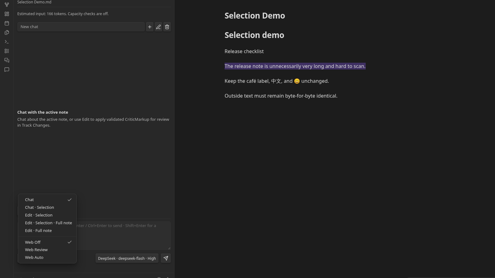

# Emend quick start

Complete this path once to verify your provider, read-only Chat, guarded editing, Track Changes review, Selection-only writing, and native undo. Use a disposable note so every result is safe to inspect or discard.

**Prerequisites:** [Install and enable Emend](INSTALLATION.md). Install and enable the separate **Track Changes** plugin for the edit-review steps. Chat does not require Track Changes.

## 1. Prepare a disposable note

Create a separate test vault or a disposable note in an existing vault. Add:

```markdown
# Emend test

This sentence have a small grammar problem.

## Ideas

- First idea
- Second idea
```

Keep the note open. The first edit adds an idea without changing this sentence, so you can use the sentence for the later Selection exercise.

## 2. Configure a provider

Open **Settings → Emend**, choose **Active provider**, and enter its API key, base URL, and model.

| Provider | Base URL | Preset model |
| --- | --- | --- |
| DeepSeek | `https://api.deepseek.com` | `deepseek-flash` |
| Kimi | `https://api.kimi.com/coding/v1` | `k3.1-pro` |
| Custom | Your OpenAI-compatible base URL | A model available on that endpoint |

The endpoint must support streaming chat completions. Emend appends `/chat/completions` to the base URL.

Reasoning effort defaults to **High**; choose a level your model supports. **Request token usage** defaults on for DeepSeek and Kimi, and off for Custom. Disable it if your provider rejects `stream_options`.

API keys are stored in Obsidian SecretStorage, not plaintext Emend settings. Use a preset or enter a model directly; optional discovery stays in Settings.

For compatibility details, see [Configure a provider](docs/guides/settings-reference.md#configure-a-provider).

## 3. Ask a question in ordinary Chat

1. Open Emend chat from the ribbon or run **Open Emend chat** from the Command Palette.
2. Choose **Chat** in **Writing and web search**.
3. Send:

   ```text
   What is the main topic of this note? Reply with one sentence.
   ```

4. Wait for the streamed answer. Use **Stop** if you want to cancel it.

**Expected result:** The answer appears in chat, and the note remains unchanged. Ordinary Chat sends bounded note context and has no note writer. No Track Changes review is needed.

Press **Enter** to send, or **Shift+Enter** for a newline. **Cmd+Enter** on macOS and **Ctrl+Enter** on Windows/Linux also send.

## 4. Make a Full-note Edit

1. Choose **Edit · Full note** in **Writing and web search**.
2. Send:

   ```text
   Add one short third idea under Ideas. Do not change the existing text.
   ```

3. Wait for the concise result in chat. It should identify `Target: Full note.` and summarize the proposed change.

**Expected result:** Emend sends the complete note, validates the model's Operations, and writes CriticMarkup through its guarded full-note path. CriticMarkup is the review markup understood by Track Changes. Chat shows a result summary rather than a raw rewritten note.

A quick action such as **Fix grammar**, **Make concise**, or **Add examples** uses the same displayed target and guarded path. Do not use one for this exercise because the next step needs the original sentence.

## 5. Review in Track Changes

Open the Command Palette and run **Open review panel** from Track Changes. Inspect the inserted third idea, then use its **Accept** or **Reject** controls.

Emend and Track Changes have separate jobs:

- **Emend** validates Operations and writes CriticMarkup.
- **Track Changes** displays that markup and supplies Accept/Reject controls.

Emend has no separate Apply, Accept, Reject, or diff interface. Whether you accept or reject the inserted idea, leave the original grammar sentence available for the next exercise.

## 6. Edit only a Selection

1. Select exactly `This sentence have a small grammar problem.` in the editor.
2. Focus Emend chat without clearing the Selection. It remains highlighted.

   

   *The Selection remains visible while chat owns focus. The menu exposes Chat, Chat Selection, three Edit targets, and three Web choices.*

3. Choose **Edit · Selection** in **Writing and web search**.
4. Send:

   ```text
   Correct the grammar without changing the meaning.
   ```

5. Wait for the concise result and inspect the CriticMarkup in Track Changes.

**Expected result:** The result identifies `Target: Selection.` Only the captured sentence receives review markup. The heading and idea list remain unchanged.

Default Selection context includes bounded surroundings. **Edit · Selection · Full note** instead sends the complete note as supporting context, but still means **full-note context, Selection-only write**. Neither choice expands the captured range.

If the Selection is empty, whitespace-only, or vanished, Emend stops before contacting the provider. It never falls back to Full-note Edit.

## 7. Restore the Selection with native undo

Return focus to the note editor. Press **Cmd+Z** on macOS or **Ctrl+Z** on Windows/Linux.

**Expected result:** Native undo removes the Selection replacement, including its CriticMarkup, and restores the complete original sentence. Redo reapplies the replacement. This recovery path is separate from Track Changes Accept/Reject review.

## 8. Recap your first success

You have verified the core boundaries:

- Ordinary Chat streamed a response without writing to the note.
- Full-note Edit sent the complete note and produced reviewable CriticMarkup.
- The separate Track Changes plugin provided Accept/Reject controls.
- Selection Edit changed only the captured range, even though it could use surrounding context.
- Native undo restored the exact original Selection.
- Chat and Edit requests occurred only after explicit submission. Preparing the note, choosing workflows, and changing model selections made no request; **Refresh models** makes a request only if you explicitly click it.

If a step fails, check the provider message in chat and the [provider settings reference](docs/guides/settings-reference.md). For installation or missing-review-plugin problems, use [installation troubleshooting](INSTALLATION.md#troubleshooting).

## Next steps

These optional workflows have their own complete recipes and expected results:

- [Focus a read-only Chat Selection](docs/guides/chat-and-context.md#focus-on-a-selection)
- [Add explicit Related notes](docs/guides/chat-and-context.md#add-related-notes)
- [Use independent chat sessions](docs/guides/chat-and-context.md#use-multiple-chat-sessions)
- [Choose models and reasoning](docs/guides/chat-and-context.md#choose-a-provider-model-and-reasoning-effort)
- [Check optional context capacity](docs/guides/chat-and-context.md#check-context-capacity)
- [Use vault instructions and skills](docs/guides/chat-and-context.md#use-vault-instructions-and-skills)
- [Use Modify Selection from the Command Palette](docs/guides/editing-and-review.md#use-modify-selection)
- [Understand edit validation](docs/guides/editing-and-review.md#how-emend-validates-edits)
- [Opt into DeepSeek Web research](docs/guides/web-research.md#use-web-review-or-auto)
- [Review privacy, recipients, and local storage](docs/guides/privacy-and-storage.md)
