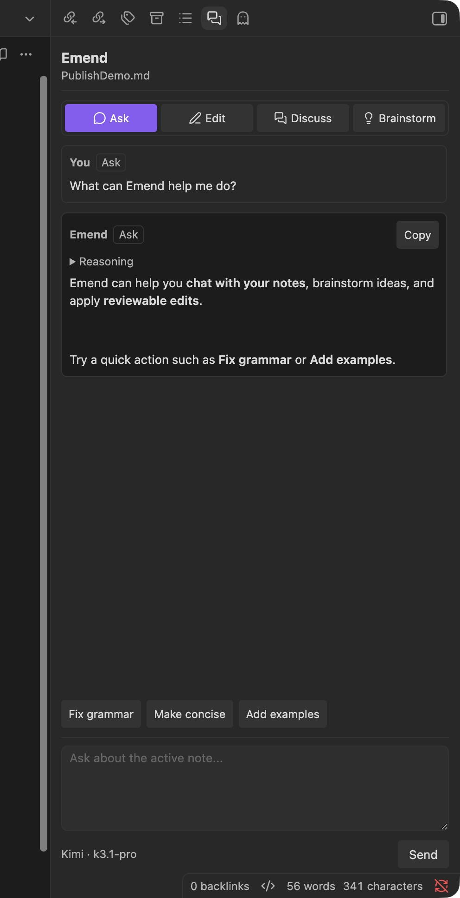
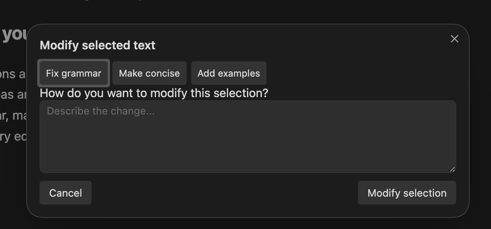

# Emend

[](https://github.com/chliu1990/obsidian-emend/actions/workflows/ci.yaml)

Emend is a desktop Obsidian plugin for streaming AI chat and safe, reviewable edits to your Markdown notes. It supports DeepSeek, Kimi Code, and custom OpenAI-compatible providers, with **Track Changes** as the review surface for every AI edit.

## Features

- **Chat with context:** Ask questions, discuss ideas, or brainstorm with the active note. Responses and reasoning stream into the sidebar; these modes never write to your notes.
- **Research on the web explicitly:** For DeepSeek `deepseek-flash` and `deepseek-v4-pro`, the read-only composer offers **Web: Off** (the default), **Review**, and **Auto**. The model can direct sequential Search/Fetch calls across multiple rounds; Review shows editable queries/URLs and extraction goals. Every readable result is inspected by one bounded AI reader, and the answering model receives only grounded extracted facts and verbatim evidence—not raw retrieval. Actual HTTP(S) sources represented by successful extractions become stable, safe citations. Expected Fetch failures become visible unread-page outcomes instead of failing the whole answer, while credential/account errors remain fatal. Folded Web activity preserves query/URL/status metadata locally. Web retrieval never writes notes. Kimi/custom providers and other models are unsupported, with no silent unsearched fallback.
- **Add notes explicitly:** Use **Add notes** in chat or Modify Selection to include bounded, read-only snapshots of other Markdown notes. Paths stay visible with remove/clear controls; selections belong to the active target note, last only for the current plugin session, and clear when the Emend plugin or Obsidian reloads.
- **Edit with confidence:** Full-note and selection edits use a closed Operations protocol—`insert`, `remove`, `replace`, and `comment`—with exact anchors and atomic validation before anything is written.
- **Target selections directly:** Select text and focus chat to default **Edit target** to **Selection**, then use a typed Edit request or any quick action. Choose **Full note** explicitly when needed. Selection edits use native Obsidian undo and show concise chat results with reasoning and token usage.
- **Review every change:** Valid operations become CriticMarkup that you can accept or reject in Track Changes. Emend has no competing diff or Apply button.
- **Work quickly:** Use **Fix grammar**, **Make concise**, or **Add examples** in chat or the selection modal, with keyboard shortcuts and native undo.
- **Keep your place:** Per-note conversations persist locally, multi-turn edits retain earlier review markup, and note/source changes invalidate stale responses.
- **Stay in control:** Include optional `AGENTS.md` instructions and skills, configure context limits, and see provider-reported or clearly labelled estimated token usage.



## Requirements

- Desktop Obsidian **1.11.4 or newer**; mobile is not supported.
- **Track Changes**, installed and enabled separately for edit review.
- A DeepSeek, Kimi Code, or custom OpenAI-compatible provider with an available model and API key.

Emend does not install other plugins automatically.

## Installation

Emend is distributed through GitHub releases and manual installation. An Obsidian Community Directory submission is not currently planned; see [publication and distribution](devel_docs/publication.md).

See the complete [installation guide](INSTALLATION.md) for build, update, removal, and troubleshooting instructions.

**Recommended: install with BRAT.** Install and enable **BRAT — Beta Reviewers Auto-update Tool** from Obsidian’s community plugins, choose **Add beta plugin** in BRAT, and enter `https://github.com/chliu1990/obsidian-emend`. BRAT installs Emend from GitHub releases and can keep it updated. Enable **Emend** and **Track Changes** after installation. See the [BRAT installation tutorial](INSTALLATION.md#install-with-brat).

Alternatively, download `emend-2.7.0.zip` from the [GitHub releases page](https://github.com/chliu1990/obsidian-emend/releases) and extract it into `<Vault>/.obsidian/plugins/`. The ZIP contains the complete `emend/` plugin folder.

For a source installation, clone this repository and run:

```bash
npm ci
npm run build
```

Then copy `main.js`, `manifest.json`, and `styles.css` into:

```text
<Vault>/.obsidian/plugins/emend/
```

Open **Settings → Community plugins**, reload plugins, and enable **Emend** and **Track Changes**.

## Quick start

1. Open **Settings → Emend** and configure a provider:

   | Provider | Base URL | Default model |
   | --- | --- | --- |
   | DeepSeek | `https://api.deepseek.com` | `deepseek-flash` |
   | Kimi Code | `https://api.kimi.com/coding/v1` | `k3.1-pro` |
   | Custom | Your OpenAI-compatible base URL | Your model |

   Emend appends `/chat/completions` to the base URL. Models and URLs remain editable.

   To populate the model selector, click the compact **Refresh models** icon in **Settings → Emend**. This explicitly sends an authenticated `GET <base URL>/models` request using the provider's API key from SecretStorage; discovery never runs automatically. Returned model IDs and display names become dropdown options, while the current selection and editable custom-model entry remain available. Discovered lists persist locally, and changing a provider's base URL or API key clears only that provider's list. Custom endpoints that do not support `/models`, HTTP failures, and malformed responses show an error without replacing the previous list.

2. Open **Emend chat** from the ribbon or Command Palette.
3. Select **Ask**, **Discuss**, or **Brainstorm** and submit a question. The note stays unchanged.
4. Optionally use the composer **Web** control with DeepSeek `deepseek-flash` or `deepseek-v4-pro`. **Off** is the default; **Review** shows each executable Search/Fetch batch with editable queries/URLs and extraction goals, while **Auto** runs validated batches directly. The model may use multiple rounds and sequential calls up to **Settings → Emend → Web tool call limit** (default 8, range 1–20), which caps executed calls. If a batch exceeds the remaining slots, Emend executes only those slots in model order, skips the excess without retrieval, and requests one final answer without Web tools. Skipped calls receive activity entries and one singular/plural incompleteness warning persists with the ready answer; exact-limit completion adds no warning. **Web output cap per call (characters)** independently bounds each complete serialized reader response (default 20,000, range 1,000–100,000), so total tool-payload growth is cap × executed calls. Every readable executed result invokes one AI reader with at most 6 model rounds and bounded local grep/read tools; the answering model receives grounded extracts rather than raw pages. The reader receives your current question and extraction goal, and retrieval plus reader rounds may incur separate charges. A failed extraction produces one aggregate incompleteness warning without raw fallback. Web is unavailable in Edit and for Kimi/custom providers or unsupported models; failures never silently become unsearched answers.
5. Optionally click **Add notes** to choose other Markdown notes as read-only context for the next request. Review their visible paths and use **Remove** or **Clear all** as needed; these per-target selections survive note switches during the current plugin session and clear when the Emend plugin or Obsidian reloads.
6. For a full-note change, choose **Edit target: Full note**, then select **Edit** or a quick action. Review the resulting markup in Track Changes.
7. For a smaller edit, select text and focus chat. **Edit target** defaults to **Selection**; enter an Edit instruction or use **Fix grammar**, **Make concise**, or **Add examples**. Only the captured range changes, native undo restores it, and chat shows a concise result with reasoning and token usage. If the selection is empty, whitespace-only, or vanishes before submission, Emend fails closed without requesting or writing instead of falling back to Full note.
8. Alternatively, run **Modify selected text with AI** from the Command Palette. The unchanged modal accepts an instruction or quick action and shares the same target note's additional-note selections, but does not add a chat result or usage/retry display.



Follow the guided [quick start](QUICK_START.md) for detailed verification steps, skills, shortcuts, and operation-based editing examples.

## Header shortcuts and build identity

The chat header lists Emend's visible default shortcuts:

| Action | macOS | Windows/Linux |
| --- | --- | --- |
| Ask mode | `⌘⇧A Ask` | `Ctrl+Shift+A Ask` |
| Edit mode | `⌘⇧E Edit` | `Ctrl+Shift+E Edit` |
| Send | `Enter / ⌘ Enter send` | `Enter / Ctrl+Enter send` |
| Newline | `Shift Enter newline` | `Shift+Enter newline` |

These labels describe the defaults; they do not change when you remap hotkeys in Obsidian. The **Open Emend chat** command has no default hotkey.

The compact identity beside the **Emend** title shows the manifest version in release builds. Development and other untagged builds show the short Git commit hash instead. Development watch mode captures that hash when it starts, so restart `npm run dev` after a commit to update the displayed identity.

## Safe editing model

Emend never lets the model rewrite a document directly. It returns a bare JSON array of closed operations against the captured source. Emend then:

1. Requires exact anchors and unique matches or explicit one-based occurrences, with typed diagnostics that identify the operation, failure code, and bounded match details.
2. Rejects malformed, ambiguous, overlapping, or markup-injecting commands. Declared-range overlap and insertion-ambiguity rules remain conservative even when smaller review hunks could otherwise coexist.
3. Rejects partial inline-code targets (`inline-code-range`), fenced-code edits (`fenced-code-edit`), and table structure changes (`table-structure-edit`) atomically. Tables allow text edits within one existing header/body cell, including safe insert/remove/replace/comment Operations and escaped pipes. Selection uses full-note context only for structural classification, never target expansion.
4. Compiles valid operations into CriticMarkup and revalidates the result. Broad replacements are reduced to deterministic Unicode word/segment-level hunks—not character-minimal fragments—with whole-target fallback for backtick-containing replacements and a bounded single-substitution fallback for expensive responses.
5. If candidate validation fails, automatically makes one correction request to the same provider (at most two provider calls total). The unchanged original request is resubmitted with the invalid response and bounded diagnostic feedback; there is no delay, backoff, or new retry setting. A second invalid response is terminal.
6. Checks that the captured file and source have not changed and that the request was not aborted, then writes once so Track Changes can review the edit. Provider failures, aborts, stale targets, and write failures are terminal rather than triggers for another correction round.

Full-note Edit always sends the complete note. Composer Selection and Modify Selection send the complete selection plus surrounding context with empty provider history, but replace only the captured range through native `editor.replaceRange`. Both selection entry points use the same minimization and validation-correction flow. Composer full-note and Selection results include all attempted rounds' token usage and retain only successful-attempt reasoning after correction. The separate selection modal keeps its existing notices without a usage footer or retry-status display. Raw operations, invalid responses, and correction feedback remain transient rather than ready-chat content or persisted history.

Model history retains each ready message's mode, historical note-write permission, and origin. Local Edit confirmations are labeled as local outcomes, not model responses. These annotations describe earlier requests only: the currently selected mode alone controls note-write access, so an earlier Edit never grants writing to a later Ask, Discuss, or Brainstorm request.

## Privacy and local data

Emend makes **no background AI requests**. Content is sent only when you explicitly submit a chat or edit action.

- Note context, prompts, recent ready history, explicitly selected additional-note snapshots, and any loaded `AGENTS.md`/skill instructions are sent to the selected provider as required for that request. Picking, opening, or switching notes sends nothing and does not read additional-note content.
- With **Web: Review** or **Auto**, ordinary main-model rounds go to DeepSeek, which may derive search queries, fetch URLs, and extraction goals from them. DeepSeek Search/Fetch endpoints receive only the visible validated query or URL; Review permits editing every proposed target and goal. Each readable result also invokes a same-provider AI reader that receives your current typed question, extraction goal, target, and source catalog—not note context, chat history, instructions/skills, additional notes, or vault content. The reader uses only bounded local grep/read tools and may incur separate charges. Retrieved text and extracted evidence are untrusted external data and never write notes or become instructions/skills. Changing the Web control, opening a note, loading a thread, or rendering citations performs no retrieval.
- Full-note Edit sends the entire active note. Read-only chat uses bounded active-note context. Composer Selection and Modify Selection send the complete selection and bounded surrounding context with empty provider history; they never truncate the selection to fit the context budget. Additional notes use a separate combined source-character budget and are read-only in every mode. Web search is unavailable to Edit, quick actions, and Modify Selection. An invalid edit candidate can cause one automatic second call to the same provider, containing the unchanged original request plus that candidate and bounded validation feedback; this possible extra call has no separate setting and may incur provider charges.
- Note and vault paths are sent only when **Include note path** is enabled. With it off, additional-note sections have generic numbered labels without their paths; with it on, they include vault-qualified paths. The local controls always show selected paths before submission.
- API keys are stored in **Obsidian SecretStorage**, not plaintext `data.json`. Legacy plaintext keys are migrated automatically.
- Ready conversations are stored locally under `<Vault>/.obsidian/emend/chats/` using schema 2; version 1 threads load and become schema 2 on the next save. Ready Review/Auto badges, sanitized result-backed citations, folded Web activity (search queries, fetch URLs, and completed/failed/skipped outcomes), main-answer reasoning, and usage may persist. API keys, raw request bodies/tool arguments/results, retrieved content, reader payloads/evidence/reasoning/rounds, transient activity, additional-note selections/snapshots, loading/error/stopped states, and buffered edit responses are not persisted.
- Deleting a note does not automatically delete its saved conversation.

See the [privacy and storage details](QUICK_START.md#8-verify-persistence-and-privacy-behavior) and [installation/removal guide](INSTALLATION.md#remove-emend) for cleanup instructions.

## Documentation

- [Installation guide](INSTALLATION.md)
- [Quick start](QUICK_START.md)
- [Architecture and implementation records](IMPLEMENTATION_PLAN.md)
- [Roadmap](ROADMAP.md) and [changelog](CHANGELOG.md)
- [DeepSeek online search implementation](devel_docs/36-deepseek-online-search.md)
- [Minimal edit ranges and guarded correction](devel_docs/37-minimal-edit-ranges.md)
- [Markdown edit safeguards and verification](devel_docs/38-markdown-edit-safeguards.md)
- [Easier selected-text editing and verification](devel_docs/39-easier-selection-editing.md)
- [Contributing guide](CONTRIBUTING.md) and [security policy](SECURITY.md)
- [CI and release workflows](.github/workflows/)
- [Deferred context-management roadmap](devel_docs/future-context-management.md)
- [Remaining web-search roadmap](devel_docs/future-web-search.md)
- [Provider and context feature backlog](devel_docs/future-provider-and-context-features.md)

Deferred documents describe possible future work, not features in this release; the web-search roadmap separately identifies the implemented DeepSeek baseline.

## Development

```bash
npm ci
npm test
npm run lint
npm run build
```

Emend uses TypeScript, strict checks, Vitest, and esbuild. The plugin is desktop-only because its provider transport uses browser `fetch` with Server-Sent Events.

## Attribution

Emend is based on Lapis Lazuli AI Assistant by Taha Yiğit Melek. See [CREDITS.md](CREDITS.md) and the MIT [LICENSE](LICENSE) for attribution.

Maintained by **Chang Liu and Kimi K3.1 Pro**. This project was driven by vibecoding with **Kimi K3.1 Pro** using **Kimi Code**.
