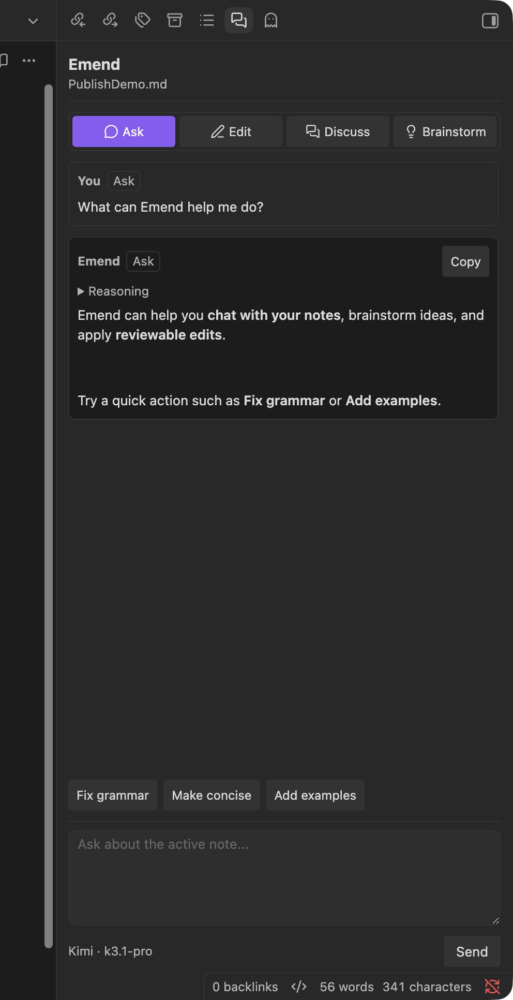
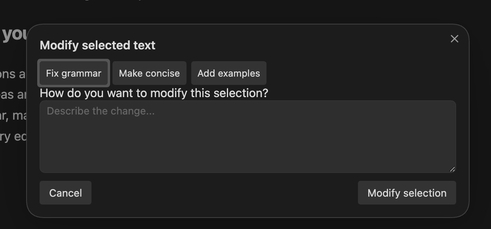

# Emend

[](https://github.com/chliu1990/obsidian-emend/actions/workflows/ci.yaml)

Emend is a desktop Obsidian plugin for streaming AI chat and safe, reviewable edits to your Markdown notes. It supports DeepSeek, Kimi Code, and custom OpenAI-compatible providers, with **Track Changes** as the review surface for every AI edit.

## Features

- **Chat with context:** Ask questions, discuss ideas, or brainstorm with the active note. Responses and reasoning stream into the sidebar; these modes never write to your notes.
- **Edit with confidence:** Full-note and selection edits use a closed Operations protocol—`insert`, `remove`, `replace`, and `comment`—with exact anchors and atomic validation before anything is written.
- **Review every change:** Valid operations become CriticMarkup that you can accept or reject in Track Changes. Emend has no competing diff or Apply button.
- **Work quickly:** Use **Fix grammar**, **Make concise**, or **Add examples** in chat or the selection modal, with keyboard shortcuts and native undo.
- **Keep your place:** Per-note conversations persist locally, multi-turn edits retain earlier review markup, and note/source changes invalidate stale responses.
- **Stay in control:** Include optional `AGENTS.md` instructions and skills, configure context limits, and see provider-reported or clearly labelled estimated token usage.



## Requirements

- Desktop Obsidian **1.11.4 or newer**; mobile is not supported.
- **Track Changes**, installed and enabled separately for edit review.
- A DeepSeek, Kimi Code, or custom OpenAI-compatible provider with an available model and API key.

Emend does not install other plugins automatically.

## Installation

See the complete [installation guide](INSTALLATION.md) for build, update, removal, and troubleshooting instructions.

For a source installation, clone this repository and run:

```bash
npm ci
npm run build
```

Then copy `main.js`, `manifest.json`, and `styles.css` into:

```text
<Vault>/.obsidian/plugins/emend/
```

Open **Settings → Community plugins**, reload plugins, and enable **Emend** and **Track Changes**.

## Quick start

1. Open **Settings → Emend** and configure a provider:

   | Provider | Base URL | Default model |
   | --- | --- | --- |
   | DeepSeek | `https://api.deepseek.com` | `deepseek-flash` |
   | Kimi Code | `https://api.kimi.com/coding/v1` | `k3.1-pro` |
   | Custom | Your OpenAI-compatible base URL | Your model |

   Emend appends `/chat/completions` to the base URL. Models and URLs remain editable.

2. Open **Emend chat** from the ribbon or Command Palette.
3. Select **Ask**, **Discuss**, or **Brainstorm** and submit a question. The note stays unchanged.
4. Select **Edit** or a quick action to make a change. Review the resulting markup in Track Changes.
5. For a smaller edit, select text and run **Modify selected text with AI**. Enter an instruction or use a quick action in the modal.



Follow the guided [quick start](QUICK_START.md) for detailed verification steps, skills, shortcuts, and operation-based editing examples.

## Safe editing model

Emend never lets the model rewrite a document directly. It returns a bare JSON array of closed operations against the captured source. Emend then:

1. Requires exact anchors and unique matches or explicit one-based occurrences.
2. Rejects malformed, ambiguous, overlapping, or markup-injecting commands.
3. Compiles valid operations into CriticMarkup and revalidates the result.
4. Checks that the captured file and source have not changed and that the request was not aborted.
5. Writes once, so Track Changes can review the edit.

Full-note Edit always sends the complete note. Modify Selection sends the complete selection plus surrounding context, but replaces only the captured range.

## Privacy and local data

Emend makes **no background AI requests**. Content is sent only when you explicitly submit a chat or edit action.

- Note context, prompts, recent ready history, and any loaded `AGENTS.md`/skill instructions are sent to the selected provider as required for that request.
- Full-note Edit sends the entire note. Read-only chat uses bounded context; selection editing sends the complete selection and bounded surrounding context.
- Note and vault paths are sent only when **Include note path** is enabled.
- API keys are stored in **Obsidian SecretStorage**, not plaintext `data.json`. Legacy plaintext keys are migrated automatically.
- Ready conversations are stored locally under `<Vault>/.obsidian/emend/chats/`. API keys, request bodies, loading/error states, and buffered edit responses are not persisted.
- Deleting a note does not automatically delete its saved conversation.

See the [privacy and storage details](QUICK_START.md#8-verify-persistence-and-privacy-behavior) and [installation/removal guide](INSTALLATION.md#remove-emend) for cleanup instructions.

## Documentation

- [Installation guide](INSTALLATION.md)
- [Quick start](QUICK_START.md)
- [Architecture and implementation records](IMPLEMENTATION_PLAN.md)
- [CI and release workflows](.github/workflows/)
- [Deferred context-management roadmap](devel_docs/future-context-management.md)
- [Deferred web-search roadmap](devel_docs/future-web-search.md)
- [Provider and context feature backlog](devel_docs/future-provider-and-context-features.md)

Deferred documents describe possible future work, not features in this release.

## Development

```bash
npm ci
npm test
npm run lint
npm run build
```

Emend uses TypeScript, strict checks, Vitest, and esbuild. The plugin is desktop-only because its provider transport uses browser `fetch` with Server-Sent Events.

## Attribution

Emend is based on Lapis Lazuli AI Assistant by Taha Yiğit Melek. See [CREDITS.md](CREDITS.md) and the MIT [LICENSE](LICENSE) for attribution.

Maintained by **Chang Liu and Kimi K3.1 Pro**. This project was driven by vibecoding with **Kimi K3.1 Pro** using **Kimi Code**.
