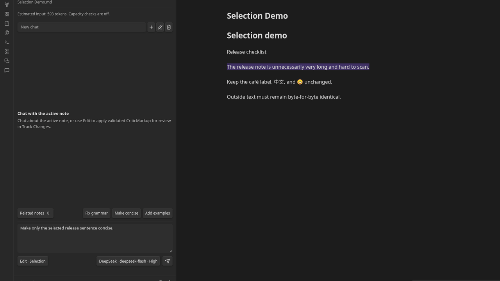

# Publication and distribution

## Current decision

Emend is distributed through the public GitHub repository and manual installation. There is **no plan to submit Emend to the Obsidian Community Directory** at this time.

- Repository: https://github.com/chliu1990/obsidian-emend
- Installation: [BRAT](../INSTALLATION.md#install-with-brat) (recommended), [release ZIP](../INSTALLATION.md#install-from-the-release-zip), or [manual source installation](../INSTALLATION.md)
- Release automation: [GitHub release workflow](../.github/workflows/release.yaml)
- Release assets: `main.js`, `manifest.json`, `styles.css`, and `emend-<version>.zip` (a ready-to-extract `emend/` folder)
- Release tags must exactly match `manifest.json`, without a leading `v`.

This decision follows the Obsidian community directory's fork policy and the project's current lineage. The original author and project remain credited in `LICENSE` and `CREDITS.md`. Do not treat the repository as an official Obsidian Community Directory listing unless this distribution decision is revisited explicitly.

Reference: [Obsidian developer policies](https://docs.obsidian.md/community-directory/developer-policies).

## Public launch readiness

This launch checklist does not change the distribution decision above: no Community Directory submission happens unless that decision is deliberately revisited.

- [ ] Public docs are current: [README](../README.md), [quick start](../QUICK_START.md), [installation](../INSTALLATION.md), [roadmap](../ROADMAP.md), and changelog match the packaged release.
- [ ] User-facing privacy, permission, and write-safety material states what is sent, what is stored locally, and which actions can modify notes.
- [ ] A supported platform and provider matrix covers desktop requirements, Track Changes, DeepSeek/Kimi/custom support, Web availability, and known limitations.
- [ ] Current screenshots and a short demo match the release and show the guarded editing flow.
- [ ] Announcement and showcase copy is concise and evidence-backed, citing shipped behavior and verification records rather than deferred features.
- [ ] A clean packaged installation and release verification pass from the release ZIP and release assets in an empty vault.
- [ ] Launch-relevant security and CI review is complete. Major TypeScript, lint, and action migrations remain separately tracked and do not block launch unless security- or release-breaking.
- [ ] Confirm the documented no-submission decision or record a new explicit decision.

Complete this checklist alongside the release checklist; it records launch material and verification, not new runtime behavior.

## Reusable 2.10 launch materials

**Preparation status:** This copy is ready for a later release announcement. It does not mean that Emend 2.10.0 is released or downloadable. Publish it only after the separate release PR, tag, assets, and packaged-install verification are complete.

### Draft release summary

Emend 2.10 brings compact Chat and Edit workflows together with explicit context and target controls. Ask read-only questions with bounded note context or explicit Chat Selection, then choose Full-note Edit or Selection-only editing when you want changes. Emend validates Operations and writes CriticMarkup through guarded paths; the separate Track Changes plugin provides Accept/Reject review, and Selection edits also preserve native undo.

Related notes adds visible, manually refreshed read-only context without making those notes edit targets. Composer provider, model, and reasoning choices save locally without submitting the draft. Live Selection highlighting keeps the current Selection visible while chat has focus. Supported DeepSeek Web Review/Auto responses now label provisional text `Draft answer — research may continue`, clear it before Review or retrieval, and promote terminal text unchanged into the ready answer.

### Short showcase copy

Chat with your notes and choose exactly where AI-proposed edits can go.

- Chat with bounded context or explicit Selection focus, without note writes.
- Add Related notes through visible, read-only path controls.
- Choose provider, model, and reasoning without submitting your draft.
- Edit a full note or only a Selection, with CriticMarkup review and native Selection undo.
- Opt into supported DeepSeek Web research with labelled drafts and terminal answers.

Emend and Track Changes are separate plugins. Track Changes presents edit review; Emend neither bundles nor automatically installs it.

[Install Emend and prepare edit review](https://github.com/chliu1990/obsidian-emend/blob/main/INSTALLATION.md)

### Requirements and boundaries for launch copy

- Desktop Obsidian **1.11.4 or newer**; mobile is not supported.
- A DeepSeek, Kimi, or custom streaming OpenAI-compatible chat endpoint, with an API key and available model.
- The separate Track Changes community plugin for CriticMarkup review. Chat does not require it, and Emend never installs it automatically.
- Web research is **Off by default** and available only in Chat and Chat Selection with DeepSeek `deepseek-flash` or `deepseek-v4-pro`. It is not universal provider support and is unavailable to Edit and Modify Selection.
- Retrieval, extraction, verification, and refinement can incur separate provider charges. Emend does not estimate provider prices.
- Follow the [installation guide](../INSTALLATION.md) for BRAT, release ZIP, source installation, and separate Track Changes setup.
- Distribution remains GitHub plus manual installation. The no-Community-Directory decision above remains unchanged.

### Visual index

The six release-matched assets below are the complete launch set. Captions are reusable; intended uses are recommendations, not additional verification claims.

| Asset | Caption | Intended use |
| --- | --- | --- |
| [Chat PNG](../docs/images/emend-chat.png) | Ordinary Chat with Web Off: the streamed answer and compact controls remain separate from the unchanged note. | README, release, or showcase still introducing compact writer-free Chat. |
| [Edit flow SVG](../docs/images/emend-edit-flow.svg) | Conceptual flow: Emend validates Operations and produces CriticMarkup; the separate Track Changes plugin presents review controls. Context never expands the write target. | Explanation of Chat, Full-note Edit, and Selection-only writer boundaries. |
| [Edit review PNG](../docs/images/emend-edit-review.png) | A guarded Full-note Edit produced two review cards. The chat stays concise while Track Changes owns Accept/Reject review; the synthetic Unicode remains intact. | Full-note Edit result and separate Track Changes review demonstration. |
| [Selection PNG](../docs/images/emend-selection.png) | The current Writing/Web menu and live Selection decoration remain visible together while chat owns focus. | Still image for explicit Selection targets, context choices, and live highlighting. |
| [Selection Edit GIF](../docs/images/emend-edit-demo.gif) | Fifteen-second silent capture at 10 fps using a local delayed mock, with idle waits shortened: one genuine Selection replacement, Track Changes review, then native undo restores the exact original bytes. | The single motion asset for the short showcase or a Selection Edit demonstration. |
| [Web flow SVG](../docs/images/emend-web-flow.svg) | Conceptual flow: Review pauses for editable arguments; Auto skips only that pause. Both paths enforce the same evidence and terminal-answer boundaries. | DeepSeek-only Web Review/Auto explanation; not generic provider artwork. |

### Verification evidence for maintainers

Use the final Stage 51 evidence for the integrated runtime matrix and Stage 52 for the Web-draft behavior details. Do not add totals across stages or present earlier branch bundles as the final bundle.

- **Final local code gate:** [Stage 51](51-2-10-stabilization.md) records review code head `5fbaef4`, **53 test files / 1,877 tests passed**, clean lint, clean production build, and clean `git diff --check`. Its built `main.js` SHA-256 was `f00e42e23ef64f0fd4ebb01b24ca40a66554b5219be49755e551c6916a0e1ddc`.
- **Final real-Obsidian matrix:** Stage 51's merge `f610a70` used `main.js` SHA-256 `48c9f4c925cb86e8caa9def153a0c19f9662a21cc20060e7642d1ba6d39ddca0`. Selection and Web evidence record root/loaded bundle equality; the minimal-edit harness copied the same root bundle but did not independently record its hash. Across six suites, **56 scenarios / 799 assertions passed**: Selection/chat **28 / 589**, focused stabilization **6 / 55**, Web draft **5 / 57**, Web transition **7 / 40**, compact composer **1 / 4**, and minimal edit **9 / 54** (scenario counts / assertions).
- **Stage 52 feature evidence:** [Stage 52](52-web-draft-streaming.md) originally recorded **5/5 Web-draft scenarios and 57/57 assertions** on build `4943150`, bundle `4e1074f7…`, with root/loaded equality, plus **1/1 compact scenario with 4/4 assertions** and a **7/7 Web-transition regression with 40/40 assertions**. Stage 51 subsequently reran those suites on the final `48c9f4c9…` bundle above; use that final identity for launch claims.
- **Environment:** Linux with isolated Xvfb displays, Obsidian **1.15.0** identified by bundled package metadata, loopback OpenAI-compatible SSE and Search/Fetch/extraction mocks, synthetic notes, and dummy SecretStorage credentials. Track Changes 2.3.0 was installed for the Selection suite. The Stage 51/52 runs used no real account or external network; Stage 40's separate exception follows.
- **Stage 40 exception:** One explicitly authorized minimal JSON-mode/tool-call/streaming compatibility probe used the local DeepSeek configuration with `deepseek-flash` and `deepseek-v4-pro`, with **no note content and no retrieval**. It did not verify extraction, verifier, refine, or answer-quality behavior. Otherwise provider behavior used loopback mocks; no paid Web retrieval or real-provider extraction or answer-quality verification was performed.

Do not claim coverage for real providers beyond that limited probe, macOS, Windows, physical input, screen readers, other Obsidian versions, or pixel comparison. Screenshots were inspected, not pixel-diffed. No real-provider answer-quality, latency, or pricing claim is supported by this evidence.

Canonical sources for the promotional claims are the [README](../README.md), [Chat and context](../docs/guides/chat-and-context.md), [Editing and review](../docs/guides/editing-and-review.md), [Web research](../docs/guides/web-research.md), [Privacy and storage](../docs/guides/privacy-and-storage.md), [Settings reference](../docs/guides/settings-reference.md), and [installation requirements](../INSTALLATION.md#requirements).

## Release checklist

1. Run clean install, lint, tests, production build, and security review.
2. Confirm `package.json`, `manifest.json`, `package-lock.json`, and `versions.json` agree on the release version.
3. Create or dispatch a matching Git tag through the release workflow.
4. Verify the GitHub Actions run and all four uploaded assets.
5. Test the release assets in a clean vault before announcing the release.
