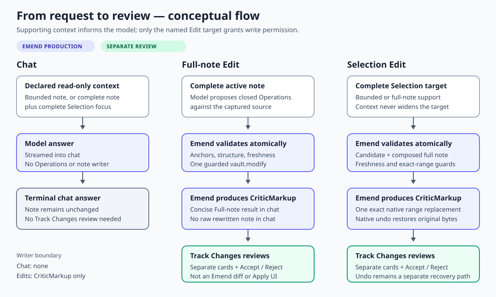
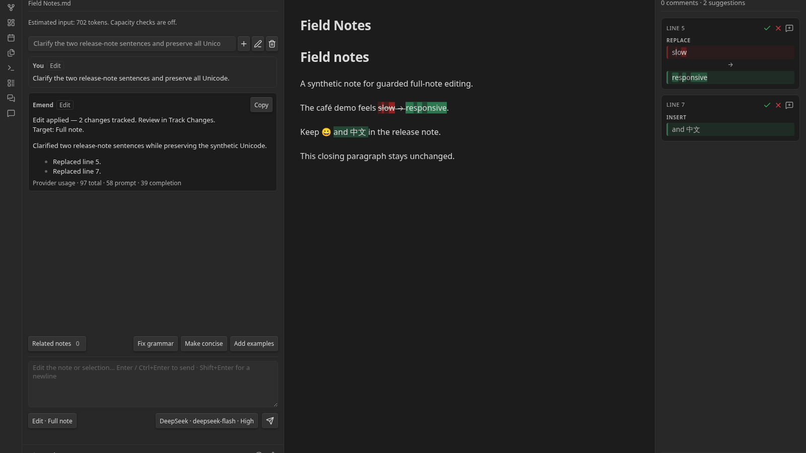
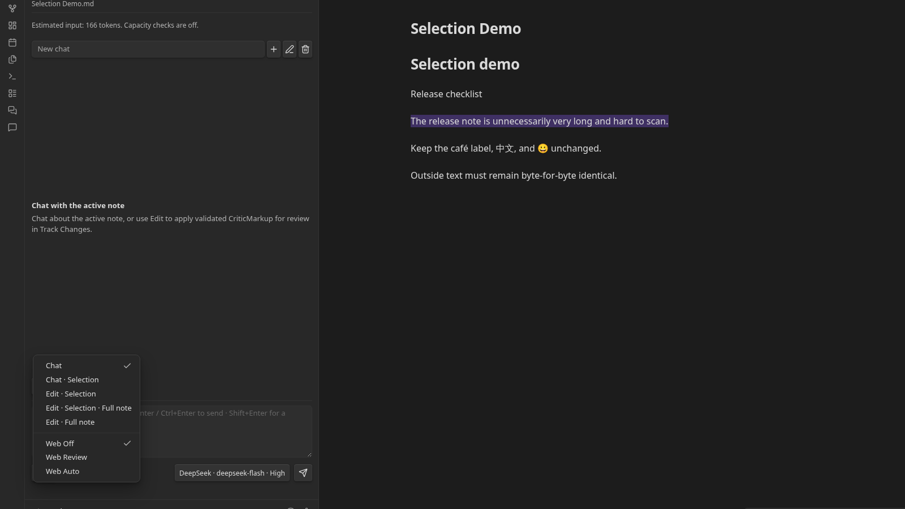
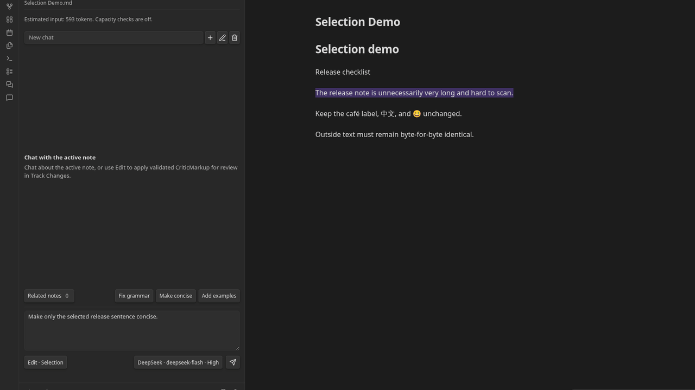

# Editing and review

Use this guide when you want Emend to propose note edits, review them, or undo a Selection edit.

You will learn how to:

- distinguish Emend's edit writer from the separate Track Changes reviewer;
- choose Full-note or Selection Edit without confusing context with write permission;
- use typed instructions, quick actions, and Modify Selection;
- understand validation, concise results, review, and native undo.

Chat never writes to a note. Only the Edit workflows below have guarded write paths. See [Write permissions](privacy-and-storage.md#write-permissions) for the canonical context and writer table.

## Emend and Track Changes

Emend and Track Changes have separate jobs:

**Emend validates Operations → Emend writes CriticMarkup through a guarded path → Track Changes displays review cards and Accept/Reject controls.**

1. **Emend validates Operations.** The model proposes closed JSON Operations against the captured note or Selection. Emend checks the complete candidate before any write.
2. **Emend writes CriticMarkup.** Valid Operations compile into CriticMarkup. Full-note Edit uses a guarded vault write. Selection Edit uses exact native range replacement.
3. **Track Changes presents the review.** The separate Track Changes community plugin visualizes the CriticMarkup and supplies Accept/Reject controls.

Emend has no competing diff, Apply, Accept, or Reject interface. Track Changes is the only CriticMarkup review surface. It is not bundled with Emend and is never installed automatically; follow the [installation requirements](../../INSTALLATION.md#requirements).

Chat needs no Track Changes because Chat has no note writer. Selection edits also preserve Obsidian's native undo, whether or not you review them first.

*Conceptual flow: Emend validates Operations and produces CriticMarkup; the separate Track Changes plugin presents review controls. Context never expands the write target.*

**Text equivalent:** Chat streams an answer without a writer. Full-note Edit validates Operations and writes CriticMarkup through one guarded `vault.modify`. Selection Edit validates the candidate and composed note, then produces CriticMarkup through one exact native range replacement that preserves native undo. Both Edit paths end in separate Track Changes review cards with Accept/Reject controls; Emend has no competing diff or Apply interface.

## Choose an edit target

Supporting context helps the model understand the request. It does not expand the permitted edit target.

| Choice | Supporting context | Only edit target | Result |
| --- | --- | --- | --- |
| **Edit · Full note** | The complete active note. | The complete captured note. | One guarded vault write with validated CriticMarkup. |
| **Edit · Selection** with Default Smart or Symmetric context | The complete Selection plus bounded surroundings. Smart uses containing and adjacent blocks; Symmetric uses before/after context. | Only the captured Selection. | One exact native range replacement with CriticMarkup and native undo. |
| **Edit · Selection · Full note** | The complete note plus a separate, complete Selection target. | Only the captured Selection. | Full-note context, Selection-only write through exact native replacement. |
| **Modify Selection** with Default or Full-note context | The complete Selection plus Default bounded surroundings or complete-note context. No chat history is sent. | Only the captured Selection. | One exact native range replacement with CriticMarkup, native undo, and a result notice. |

Automatic Edit targeting chooses Selection only when usable selected text exists. Otherwise, it chooses Full note. You can also choose an explicit target in **Writing and web search**. Selecting text alone never chooses Chat Selection or grants a wider write target.

The Default Selection policy follows **Smart selection context** in [Settings](settings-reference.md#control-context-and-history). Full-note Selection context ignores the surrounding-context budget, but never expands the edit target.

## Edit the full note

**Outcome:** Propose reviewed changes anywhere in the active note through Emend's guarded vault writer.

**Prerequisites:** Open a Markdown note and [configure a provider](settings-reference.md#configure-a-provider). Install and enable Track Changes separately if you want review cards.

**Actions:**

1. Open Emend chat and choose **Edit · Full note** in **Writing and web search**.
2. For a typed instruction, enter an editing request, such as `Make the introduction clearer without changing its meaning.`
3. For a quick action instead, click **Fix grammar**, **Make concise**, or **Add examples**. These three quick actions appear only in Edit.
4. If you typed an instruction, submit it once. If you clicked a quick action, that click already submitted it; do not click Send again. Wait for validation and the guarded write to finish.
5. Read the concise result in chat, then review the CriticMarkup with Track Changes.

A quick action uses the maintained target and Selection-context policy. It saves your typed draft without consuming it, then follows the same submission path as a typed instruction. It does not create a separate writer or provider flow.

**Observable result:** The chat result identifies **Target: Full note.** and summarizes the tracked changes. An optional model summary and bounded change bullets can appear, but raw Operations do not. If nothing needs changing, the result says `No changes were needed.` and performs no write.

**Recipe recap:** You sent the complete note, applied validated CriticMarkup through one guarded vault write, and should observe a concise result plus Track Changes review cards.

*A guarded Full-note Edit produced two review cards. The chat stays concise while Track Changes owns Accept/Reject review; the synthetic Unicode remains intact.*

## Edit a Selection from the composer

**Outcome:** Change only the captured Selection while using either bounded surroundings or the complete note as supporting context.

**Prerequisites:** Select non-whitespace text in the active Markdown note. Keep that Selection available until submission, and configure a provider.

**Actions:**

1. Focus Emend chat without clearing the Selection.
2. Choose **Edit · Selection** for Default context, or **Edit · Selection · Full note** for complete-note context.
3. For a typed instruction, enter your request. For a quick action instead, click **Fix grammar**, **Make concise**, or **Add examples**.
4. If you typed an instruction, submit it once. If you clicked a quick action, that click already submitted it; do not click Send again. Wait for the concise Selection result.
5. Review with Track Changes, or use native undo to restore the original Selection.

**Edit · Selection · Full note** means **full-note context, Selection-only write**. The model can read the complete note, but Emend replaces only the exact captured range. The complete Selection is sent even when it exceeds the ordinary context budget.

An empty, whitespace-only, or vanished Selection fails closed. Emend shows `Select non-whitespace text first.` before adding messages, saving chats, reading additional context, or contacting a provider. It never falls back to Full-note Edit.

**Observable result:** The result identifies **Target: Selection.** Text outside the captured range remains unchanged. Native undo restores the complete original Selection; redo reapplies the CriticMarkup replacement.

**Recipe recap:** You chose bounded or complete-note support, and should observe exactly one native Selection replacement with no outside-target edit or Full-note fallback.

*The current Writing/Web menu and live Selection decoration remain visible together while chat owns focus.*

*Fifteen-second silent capture at 10 fps using a local delayed mock, with idle waits shortened: one genuine Selection replacement, Track Changes review, then native undo restores the exact original bytes.*

## Use Modify Selection

**Outcome:** Edit a captured Selection from the Command Palette without adding a chat exchange.

**Prerequisites:** Select non-whitespace text in a Markdown note and configure a provider.

**Actions:**

1. Run **Modify selected text with AI** from the Command Palette.
2. Keep **Selection context** at Default, or choose **Full note**. The selector resets to Default each time the modal opens.
3. Optional: To include other Markdown notes, click **Add notes**, select paths, and review the **Additional notes** list. Use **Remove** or **Clear all** as needed.
4. For a typed instruction, enter your request. For a quick action instead, click **Fix grammar**, **Make concise**, or **Add examples**.
5. If you typed an instruction, submit it once. If you clicked a quick action, that click already submitted it; do not submit again. Wait for the result notice.
6. Review with Track Changes, or use native undo.

Default uses your Smart or Symmetric setting. Full note sends the complete note as supporting context, but only the Selection can change. Additional-note contents are bounded, read fresh at submission, and remain read-only; the notes never become edit targets. The modal sends no chat history and shows notices rather than chat, usage, or retry displays.

**Observable result:** A successful action replaces only the captured range and shows a result notice. A failed validation, stale source, cancellation, or provider error replaces nothing and leaves the controls available for retry.

**Recipe recap:** You submitted a Selection-only command with Default or full-note support, and should observe a native replacement, a notice, and no chat response.

## How Emend validates edits

The model does not write arbitrary response text into your note. It returns Operations that refer to exact text in the captured source.

- **Exact anchors:** Emend resolves the requested original text and occurrence. Missing, ambiguous, overlapping, or outside-target Operations reject the candidate.
- **Atomic validation:** Every Operation must pass before anything is written. One invalid Operation prevents the entire edit.
- **Structural safeguards:** Checks protect inline code, fenced code, table structure, and existing CriticMarkup. Selection candidates are also checked in the composed full note.
- **CriticMarkup compilation:** Valid replacements become deterministic review markup. Emend minimizes replacement ranges where safe rather than rewriting the whole target by default.
- **Freshness checks:** Full-note Edit requires the saved note and every open editor for that note to match the captured source. Selection Edit requires the current editor and active target to match before replacement.
- **One candidate correction:** A candidate-validation failure can trigger one automatic correction request to the same provider and model. It includes the original request, invalid candidate, and bounded feedback. A second invalid candidate writes nothing.

Provider errors, cancellation, stale sources, and write failures do not start that candidate-validation correction. No failure path applies a partial candidate.

For technical details, see [Stage 37: Minimal edit ranges and guarded correction](../../devel_docs/37-minimal-edit-ranges.md), [Stage 38: Markdown edit safeguards](../../devel_docs/38-markdown-edit-safeguards.md), and [Stage 51: 2.10 stabilization](../../devel_docs/51-2-10-stabilization.md).

## Review and undo

Open the Command Palette and run **Open review panel** from Track Changes.

Track Changes owns the review experience. Use its review cards and Accept/Reject controls to resolve the CriticMarkup that Emend wrote. Emend does not add another Apply or diff panel.

For Selection edits, Obsidian's native undo remains a separate safety path. It undoes the exact native replacement, including its CriticMarkup, and restores the captured original text. Full-note Edit uses the guarded vault writer instead; review its proposed changes through Track Changes.

Composer results stay concise. They report the target, an optional model-written summary, and bounded line-based change bullets. The model summary never enters the note. Raw candidates, Operations, and correction feedback remain out of ready chat content and saved chats; see [Local data](privacy-and-storage.md#local-data).

## Recap

- **Chat never writes.** It needs no Track Changes and produces no edit review.
- **Full-note Edit writes the complete captured note only through the guarded vault path.** Track Changes reviews the resulting CriticMarkup.
- **Selection Edit uses exact native replacement and preserves native undo.** Text outside the captured Selection cannot change.
- **Edit · Selection · Full note means full-note context, Selection-only write.** Complete-note support never expands the target.
- **Track Changes is separate.** Emend neither bundles nor automatically installs it, and provides no competing diff or Apply UI.
- **Validation is atomic.** A failed candidate, stale source, or vanished Selection produces no partial write or silent fallback.

Next, review [Privacy and storage](privacy-and-storage.md) for request and persistence boundaries, or use [Web research](web-research.md) for read-only DeepSeek research.
