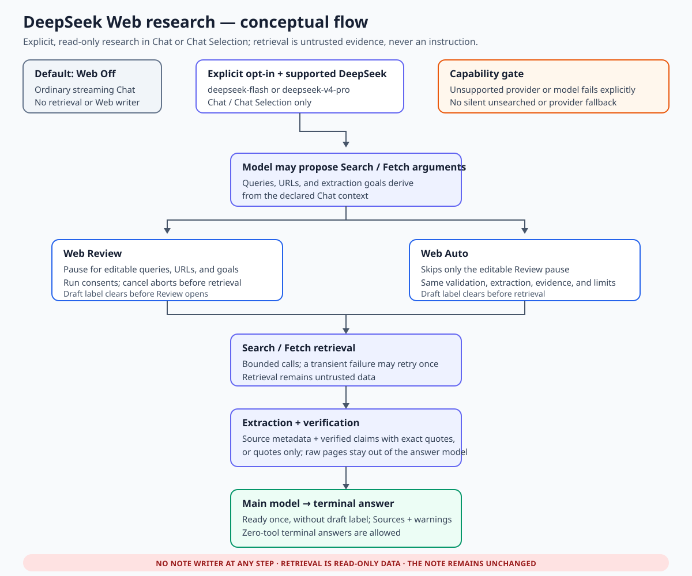

# Web research

Use this guide when you want a supported DeepSeek model to search or read Web sources during Chat.

You will learn how to:

- meet the provider requirements and understand sharing and possible charges;
- complete one Web Review exercise and use the shorter Web Auto variant;
- distinguish provisional drafts from terminal answers;
- interpret citations, limits, and incompleteness warnings.

Web research is **Off** by default. It is available only in Chat and Chat Selection with DeepSeek `deepseek-flash` or `deepseek-v4-pro`. Edit, Edit quick actions, Modify Selection, Kimi, custom providers, and other DeepSeek models cannot use it.

An unsupported provider or model produces an explicit capability error. Emend never silently continues as ordinary, unsearched Chat. Web research has no note writer and never falls back to another provider.

The main DeepSeek model receives the ordinary Chat context. It may derive search queries, fetch URLs, and extraction goals from your note and chat. **Web Review** shows those arguments for editing before retrieval. **Web Auto** skips only that review pause.

Successful retrieval may be billed separately. Extractor, verifier, and refine model rounds may also incur separate charges. A transient Search or Fetch failure may be retried once. A failed retrieval call still counts toward the configured call limit. Emend does not know your provider's prices or estimate charges. See [Web sharing and charges](privacy-and-storage.md#web-sharing-and-charges) for the canonical recipient and disclosure boundary.

*Conceptual flow: Review pauses for editable arguments; Auto skips only that pause. Both paths enforce the same evidence and terminal-answer boundaries.*

**Text equivalent:** Web is Off by default and limited to supported DeepSeek models in Chat or Chat Selection. After an explicit opt-in, the model may propose Search or Fetch arguments. Review allows editing and consent before retrieval; Auto skips only that review pause. Any retrieval passes through extraction and verification before the main model produces a terminal answer with any supported Sources and applicable warnings. A zero-call answer is also valid. Unsupported configurations fail without unsearched fallback, and no step has a note writer.

## Use Web Review or Auto

**Outcome:** Review and run any proposed retrieval batch, then receive one terminal answer without changing the note. A valid zero-call result needs no Review or retrieval activity and may have no citations.

**Prerequisites:** [Configure DeepSeek](settings-reference.md#configure-a-provider) with an API key and exactly `deepseek-flash` or `deepseek-v4-pro`. Open a Markdown note and Emend chat. Decide whether the note-derived arguments and possible provider charges are acceptable.

### Complete Web Review exercise

1. Choose **Chat** or **Chat · Selection** in **Writing and web search**. Chat Selection requires a usable Selection and sends the complete note plus complete read-only focus.
2. Choose **Web Review** in the same menu. Changing this choice alone makes no request.
3. Type a research question, such as `Find the official documentation for this plugin API and summarize the setup requirements.` Then submit once.
4. When the model streams provisional answer text, observe the exact label `Draft answer — research may continue`. Treat that text as unfinished.
5. If the model proposes retrieval, the draft text and label clear before **Review** opens. No Search or Fetch from that batch has run yet.
6. If **Review** opens, review each proposed search **query** or fetch **URL** and its **extraction goal**. Edit them to name the information you want, then click **Run**. Closing or cancelling the review aborts the submission instead of running retrieval.
7. If retrieval runs, observe the folded activity as Search/Fetch and extraction proceed. Later provisional content also carries the draft label and clears before another Review or retrieval batch.
8. Read the terminal answer and, when present, its **Sources** section. Expand any activity and source disclosures to inspect the completed outcomes and actual source links.
9. Confirm that the answer appears once, without the draft label, and that the note remains unchanged.

If the model proposes no retrieval, no Review modal opens and no retrieval activity appears. The answer may have no citations, but it still appears once as a terminal answer without the draft label, and the note remains unchanged. A supported model choosing zero calls is not a silent fallback.

**Observable result:** If retrieval was proposed, only the reviewed executable calls can retrieve content after **Run**. With or without retrieval, the terminal answer becomes the ready answer with any result-backed citations and applicable warnings. Provisional text is gone, and the note is byte-for-byte unchanged because Chat has no writer.

**Recipe recap:** You opted into DeepSeek research, inspected and edited any proposed arguments, and consented with **Run** when retrieval was proposed. You should observe one terminal answer, any result-backed citations, and no note write, whether or not retrieval occurred.

### Web Auto variant

1. Keep the same supported DeepSeek provider and Chat prerequisites.
2. Choose **Web Auto**, enter the research question, and submit once.
3. Observe the same labelled provisional drafts. If retrieval is proposed, observe the activity; each draft clears before retrieval begins.
4. Read the terminal answer, any citations, and any warnings. Confirm that the note remains unchanged.

Auto performs the same argument validation, extraction, evidence checks, and limit enforcement as Review. It skips only the editable review pause, so proposed queries, URLs, and goals are not shown for approval before execution. **Stop** cancels the active submission.

**Observable result:** Any proposed retrieval runs without a Review modal. Auto promotes only terminal content to the ready answer and produces no note write. The same explicit zero-call result is valid and is not silent unsearched fallback.

## Drafts and final answers

Web Review and Auto can stream answer content before the model finishes researching. That content always appears under the exact label `Draft answer — research may continue` with muted styling. It is provisional, not an approved result.

When a round returns tool calls, Emend clears the draft text and label before Review opens or any Search/Fetch executes. Research activity does not leave an earlier draft masquerading as the answer.

A terminal round's streamed content is promoted unchanged into the ready answer. Emend does not re-emit, retype, or duplicate it. The ready answer has no draft label. Draft text is transient: it is not saved in ready chats, copied as the answer, or sent as later chat history. Stopped or failed drafts persist no assistant answer.

Web Off keeps ordinary streaming and never shows the draft label. A zero-tool Web round can stream a labelled draft and then promote it directly to the answer without citations.

## Evidence and citations

Every readable Search or Fetch result goes through a same-provider extraction and verification loop. The main answering model receives actual source metadata plus verified claims with exact quotes, or quotes-only evidence. It does not receive raw retrieved pages or unverified extractor claims from that loop.

Only successfully represented, actual HTTP(S) sources become stable `S1`, `S2`, and later citations. The ready answer can show a folded **Sources** list, and Copy includes that list. Retrieved text remains untrusted external data, not instructions or an edit target.

The extractor receives the current question, extraction goal, retrieval target, and source catalog without chat history or note context. Verification and refinement use isolated claim-and-quote context. See [What leaves the vault](privacy-and-storage.md#what-leaves-the-vault) rather than treating retrieval as a second full-note submission.

## Limits and incompleteness warnings

Two independent settings bound Web work:

| Limit | Default and accepted range | What to expect |
| --- | --- | --- |
| **Web tool call limit** | Default `8`; integers `1`–`20` | Caps executed Search/Fetch calls. Failed calls count. Calls beyond the remaining slots are skipped without retrieval or reader work. |
| **Web output cap per call (characters)** | Default `20000`; integers `1000`–`100000` | Caps each complete serialized extraction payload independently. Total payload growth is at most cap × executed calls. |

Change them through [Web research limits](settings-reference.md#set-web-research-limits). These are call and character limits, not exact token counts or billing estimates.

A ready answer can include one warning for each applicable condition:

| Warning | What it means |
| --- | --- |
| **Unread pages** | A requested Fetch failed or returned an empty page. The answer may lack that source. |
| **Extraction failures** | Emend could not extract usable information from one or more queries. Other successful evidence can still support the answer. |
| **Failed searches** | A Search failed or produced no usable result. Other successful evidence can still support the answer. |
| **Omitted evidence** | Emend dropped a claim, quote, or source result to fit the per-call output cap. |
| **Skipped calls** | The configured call limit left proposed calls unexecuted. Emend forces a terminal answer without further retrieval. |

These warnings identify possible incompleteness; they are not hidden retries or partial note edits. Activity rows can show transient failure detail, while saved chats keep sanitized outcomes and the warning text. Raw retrieval, reader artifacts, and draft text do not persist.

## Technical records and verification scope

For protocol and presentation internals, see:

- [Stage 36: DeepSeek online search](../../devel_docs/36-deepseek-online-search.md);
- [Stage 40: Per-query Web extraction](../../devel_docs/40-web-content-budget-diagnostics.md);
- [Stage 48: Web response transition](../../devel_docs/48-web-response-transition.md);
- [Stage 52: Web draft streaming](../../devel_docs/52-web-draft-streaming.md).

Web behavior was verified with local loopback chat, Search, Fetch, and extraction mocks with dummy credentials. Stage 40 also records one authorized minimal JSON-mode compatibility probe using the local DeepSeek configuration, with no note content or retrieval. No real-provider extraction or answer-quality verification and no paid Web retrieval were performed. These guides therefore make no real-provider answer-quality, latency, or pricing claim.

## Recap

- **Web is Off by default and read-only.** Only DeepSeek `deepseek-flash` and `deepseek-v4-pro` support it in Chat and Chat Selection.
- **Unsupported combinations fail explicitly.** There is no silent unsearched fallback, fallback provider, or note writer; the note remains unchanged.
- **Review pauses for editable queries, URLs, and extraction goals when retrieval is proposed.** Any proposed Auto retrieval skips only that pause. Retrieval and reader rounds can incur separate charges; a zero-call answer is valid.
- **Provisional content uses `Draft answer — research may continue`.** It clears before Review or retrieval. Terminal content becomes the answer once, without duplication or the draft label.
- **Evidence is bounded and inspectable.** Citations come from represented sources, and unread, extraction, search, omission, and skipped-call warnings disclose possible gaps.
- **Verification used loopback mocks, plus one minimal JSON-mode compatibility probe with no note content or retrieval.** No real-provider extraction or answer-quality verification and no paid Web retrieval were performed.

Next, review [Privacy and storage](privacy-and-storage.md) for sharing and persistence, or return to [Chat and context](chat-and-context.md) for writer-free note questions.
